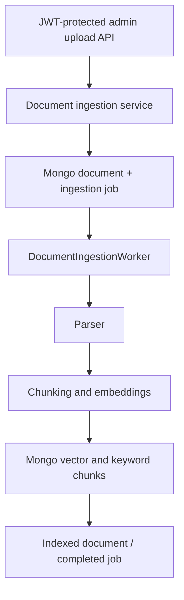

# Durable document ingestion

When invoked by an authorized application path, the ingestion service writes a document record and durable job before responding. The worker atomically claims eligible jobs with a Mongo lease, so multiple instances cannot process the same active lease. Expired processing leases become eligible again.

Failures are retried with exponential backoff and jitter. After `MaxAttempts`, the job moves to `DeadLetter`; document content and embeddings are never logged. `IDocumentStorage` has a local development implementation and an S3 implementation. AWS SAM configures a private encrypted bucket with Lambda read/write permissions; local file storage should not be used across instances.

The admin upload and index-management routes use JWT Bearer validation and require the `RagAdmin` role. In production, an HTTPS issuer and audience must be configured before the API starts.
